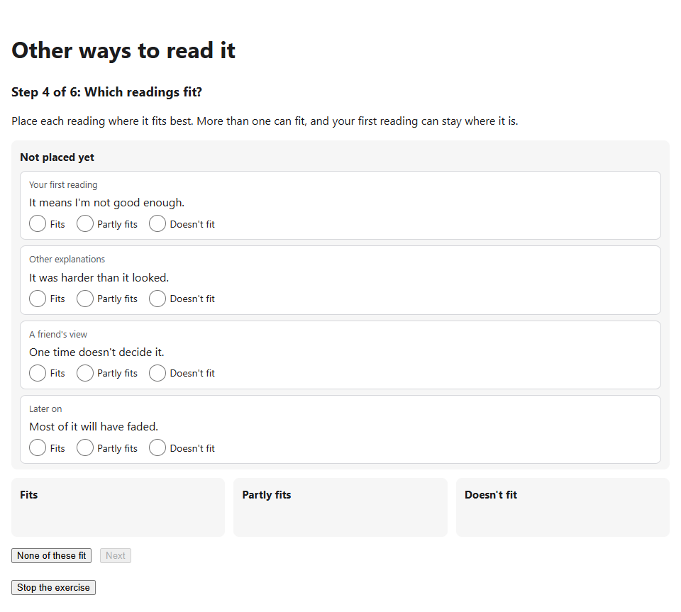
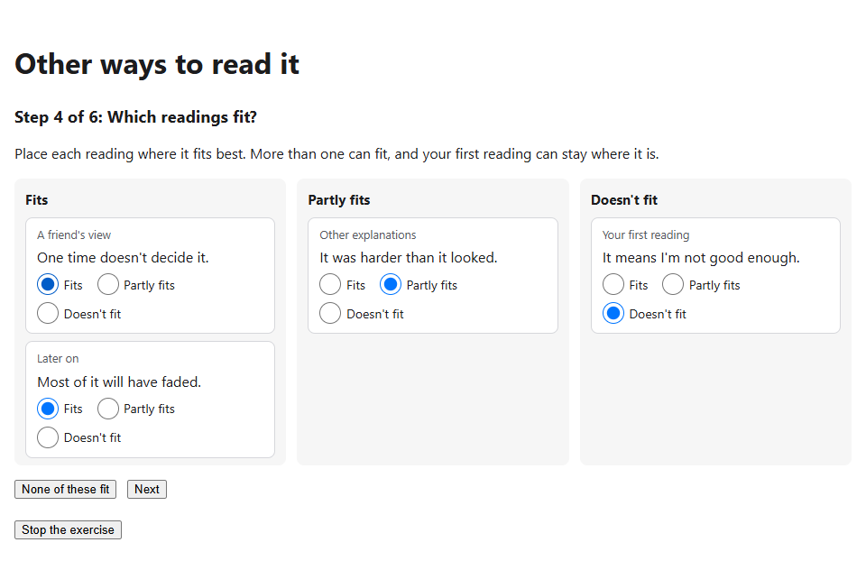
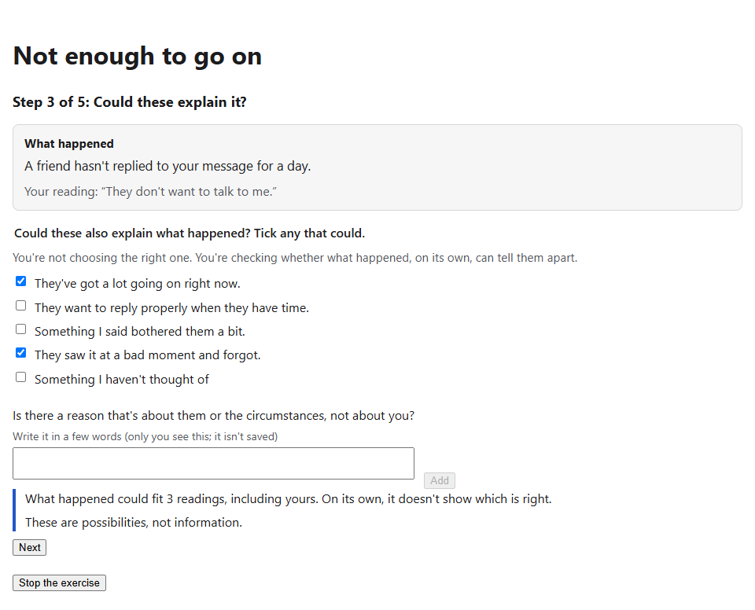
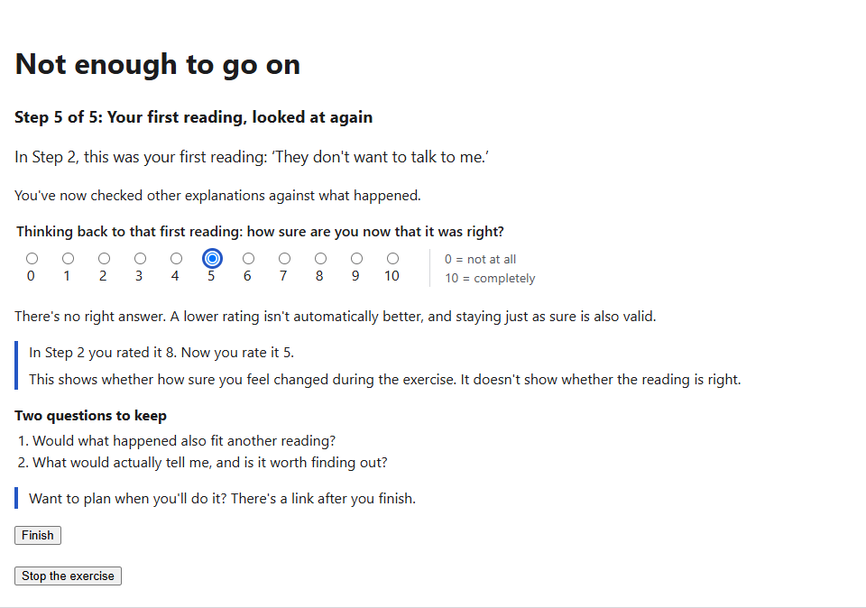

# CS1 and CS3: Visual System audit

> **Status:** audit, 2026-11-08. Docs only: no code, content or exercise changed. **Decisions A1 and A2 (§6) accepted 2026-11-09, both as recommended:** CS1 and CS3 stay without figures, and v0.3 stays unassigned until a composition pulls it.
> - **Why:** the release plan (`visual-system.md` §14) named CS1 and CS3 as the compositions that would validate v0.3 (layout generators and layout transitions), and §6.6 listed "CS1 and CS3 visuals" as legacy, waiting to migrate. Both were written before the CS3 redesign (2026-11-03) and before the pull rule was applied to v0.2. This audit checks what is actually on screen.
> - **Method:** the same as the CS2 proposal (`cs2-visual-proposal.md` §3). Run the exercise, then for each visual element name its purpose (`visual-policy.md` principle 6) and whether a figure would serve it better than what is there.
> - **Screenshots:** in `docs/cs1-cs3-visual-audit/`, captured from the running development build with the test database.

## Contents
1. In short
2. CS1 · Other ways to read it
3. CS3 · Not enough to go on
4. Across the platform
5. What it means for the Visual System
6. Decisions

---

## 1. In short
- **Neither exercise has a figure.** CS1's fit board is an interaction control built from HTML: cards with radio buttons, in three columns. CS3 has no visual element beyond text, tick boxes and the shared 0–10 scale; its share-of-10 step was removed in the redesign.
- **Nothing in either would be served better by a figure.** Each element is either how the person answers (and native controls are the right form for that) or words that a picture would only repeat. The one tempting candidate, the before-and-after ratings, must not become a figure: a chart would show a direction the exercises explicitly say isn't expected (§2.3).
- **So nothing pulls v0.3 as planned.** With MCII and CS2 done, every figure outside the frozen experiment exercises is on the Visual System (§4). v0.3 stays unassigned until a composition pulls it (decision A2).

## 2. CS1 · Other ways to read it

### 2.1 The steps
| Step | What's on screen | Screenshot |
|---|---|---|
| 1. Your first reading | Cards to pick from (shared `CardPick`), with "My own reading" | — |
| 2. How it feels now | Two 0–10 scales and a three-way question | `cs1-feel-before.png` |
| 3. Other ways to see it | Three lenses, one at a time: a short lead and cards | `cs1-lens.png` |
| 4. Which readings fit? | The fit board: unplaced cards above three columns, "Fits", "Partly fits" and "Doesn't fit". Each card has three radio buttons; choosing one moves the card into that column | `cs1-board-start.png`, `cs1-board-filled.png` |
| 5. Looked at again | The same two scales, then the earlier and current numbers in words | `cs1-feel-after.png` |
| 6. What you're keeping | A list of the readings placed in "Fits" | — |

| The board before placing | The board filled |
|---|---|
|  |  |

### 2.2 What each element does
| Element | Purpose | What it does | A figure instead? |
|---|---|---|---|
| **Board columns** | interaction, understanding | Show every reading's place at once. "More than one can fit" is visible as several cards in "Fits" | No. The columns *are* the layout of the answer; drawing them as a figure would duplicate the controls and lose the native keyboard path, which the e2e test walks |
| **Radio buttons on each card** | interaction | The input. Keyboard and screen-reader users place a card without dragging, and focus follows the moved card | No: native controls first (`visual-policy.md` §6) |
| **Card tags** ("Your first reading", "A friend's view") | understanding | Where each reading came from, so the first reading is one card among others | No |
| **Equal cards, equal columns** | none needed beyond the above | No reading or column is styled as better | This already meets §5.2 and §5.5 (no steering, no judgement). A figure would add a risk of breaking them |
| **Before-and-after numbers** (step 5) | feedback | The person's own ratings, in words, shown only after rating again | **No, deliberately** (§2.3) |

### 2.3 Why the ratings stay in words
Step 5 says "These numbers don't have to go down, and they don't have to move together." CS3 says the same about certainty. A bar pair, an arrow or a line from "before" to "now" would:
- **show a direction** the exercise says isn't expected, and make a decrease look like the intended outcome (`visual-policy.md` §5.3: nothing implies an outcome is likely; §5.5: nothing marks a feeling as good or bad)
- **become a score** to improve on next time, which the platform's "no reward" rule rules out (§5.4)

The text form is the right one. It's also what the 2026-11-04 change to both exercises settled: no direction is expected, and the earlier numbers appear only after rating (`cognitive-shifts-design.md`, "CS1 ratings made explicit" and "CS3 ratings made explicit").

### 2.4 Problems found
None that a figure would fix. The board works with the keyboard alone and passes axe in light and dark (the existing `cognitive-shifts` e2e spec). Nothing is clipped or hidden in the screenshots.

## 3. CS3 · Not enough to go on

### 3.1 The steps
| Step | What's on screen | Screenshot |
|---|---|---|
| 1. An unclear situation | Situations to pick from, or the person's own | — |
| 2. Your first reading | Cards, and a 0–10 certainty scale | — |
| 3. Could these explain it? | "What happened" (the facts, with the person's reading under them) next to tick boxes for other readings; then a note in words: "What happened could fit 3 readings, including yours" | `cs3-fit.png` |
| 4. Can you find out? | Ways to find out, with a follow-up note | — |
| 5. Looked at again | The certainty scale again, the earlier and current numbers in words, and two questions to keep | `cs3-after.png` |

| Step 3 | Step 5 |
|---|---|
|  |  |

### 3.2 What each element does
| Element | Purpose | What it does | A figure instead? |
|---|---|---|---|
| **"What happened" panel** | understanding | Puts the facts next to the question, so the step reads as checking whether the facts can tell readings apart | No: it's the person's situation in words; a picture of "a message not replied to" would add nothing the words don't say, and the person's own situation can't be drawn at all (`visual-policy.md` §5.8) |
| **Tick boxes** | interaction | Which other readings could also explain it | No: native controls |
| **Note: "could fit 3 readings"** | feedback | Reports only the person's own judgement, as a count | No. A figure of three equal marks would carry the same count with less clarity, and invites reading the marks as likelihoods. The redesign removed the share-of-10 because estimating likelihoods isn't checking evidence, and its comparison with step 2's certainty wasn't valid (`cs3-redesign-proposal.md` §2). A figure would bring likelihood back by its look |
| **Before-and-after certainty** | feedback | As in CS1 | No, for the reasons in §2.3 |
| **Two questions to keep** | understanding | Questions to take into the next ambiguous moment | No |

### 3.3 Problems found
None.

## 4. Across the platform
Every figure in the application, from a search of the code:

| Figure | Where | Status |
|---|---|---|
| MCII path | `experiences/mcii/mcii.ts` | Visual System scene `mcii.path@4` (development branch) |
| CS2 cause map | `experiences/cognitive-shifts/cs-why-it-happened.ts` | Visual System instrument `cs2.cause-map@1` (development branch; R2 pending) |
| Game preview, tracking game | `experiences/state-reset/` | Experiment exercises: frozen until after the n-of-1 study |
| Icons | `shared/icon.ts` | Outside scope |
| The Visual Lab | `pages/lab/lab-page.ts` | The review tool itself |

Action Bridge, goal restatement and the rating step have no figures. Once MCII and CS2 are merged, no non-experiment exercise has a legacy figure left.

## 5. What it means for the Visual System
- **§6.6, the legacy list:** the "CS1 and CS3 visuals" row described something that doesn't exist. It's corrected to say the audit found no figure, and nothing to migrate (decision A1).
- **§14, v0.3:** its validators were CS1 and CS3, so by the pull rule nothing pulls it. Layout generators and layout transitions stay designed and unbuilt, like S6 and value transitions after the v0.2 rescope. By decision A2, v0.3 stays unassigned until a composition pulls it; v0.4 onwards keep their numbers.
- **What could pull next** (none is in hand today):
  - a new exercise, or a reviewed change to an existing one, that needs a figure to communicate (Tier 1 or Tier 2)
  - the first approved Attention task, which pulls the stimulus lane (v0.4); it waits for the n-of-1 study

## 6. Decisions
| # | Decision | Outcome |
|---|---|---|
| A1 | Do CS1 and CS3 stay without figures? | **Accepted 2026-11-09: (a)**, nothing to migrate |
| A2 | What happens to v0.3 in the release plan? | **Accepted 2026-11-09: (a)**, unassigned until a composition pulls it |

The alternatives as they were put:

**A1. Do CS1 and CS3 stay without figures?**
- **(a) Yes: record "nothing to migrate"** for both, with this audit as the reason. *Recommended:* no element would be served better by a figure, and the obvious candidate (the ratings) would break §5.3–§5.5.
- **(b) Propose a Tier 1 illustration** for one or both, for example "several views of one situation" in CS1. Each would need a named purpose and a proposal like CS2's before anything is built. My concern: the concept is already carried by the cards and the board, so an illustration would mostly be decoration, and a picture that places readings risks weighting one of them.

**A2. What happens to v0.3 in the release plan?**
- **(a) Leave v0.3 unassigned until a composition pulls it.** Layout generators and layout transitions stay designed, not built. v0.4 onwards keep their numbers and triggers. *Recommended:* it's the pull rule as applied to v0.2, and it doesn't invent work.
- **(b) Renumber:** drop v0.3 and move the stimulus lane up. It's tidier, but the documents refer to "v0.4" for the stimulus lane in several places, and the order says nothing about timing anyway.
- **(c) Keep v0.3 for CS1 and CS3** and look for something to build there. Not recommended: it reverses the pull rule.
