# CS2 cause map: Visual System proposal (v0.2)

> **Status:** proposal, 2026-11-08. **C1–C5 approved and built** on the development branch: change 1, then the rebuild as the instrument `cs2.cause-map@1` (§5.5), integrated into CS2. For review in the Visual Lab (R2) and in the test environment (R3, the psychology-trained reviewer). C6 decided (§8).
> - The screenshots are in `docs/cs2-visual-proposal/`. The "current" ones show the chart before change 1. The "built" ones show change 1 in the running development build (they replace the mock-ups the proposal was reviewed with, which matched them).
> - It follows the approach that worked for MCII: start from what exists, change only what serves a named purpose (`visual-policy.md` principle 6), keep the exercise looking like the rest of the application, and show one small change first.
> - CS2 stays development-only. Its own release gates (content review, full texts; `cognitive-shifts-design.md` §9) are unchanged by this proposal.

## Contents
1. In short
2. The chart today
3. What each element does
4. What's wrong today
5. The proposal
6. What it means for the Visual System
7. Order of work and reviews
8. Decisions for you

---

## 1. In short
- **Keep the chart as it is:** the same two-axis map beside the same sliders, the same numbered marks, the same list under it, the same steps. It already works well and its form was approved (`cognitive-shifts-design.md` §4).
- **Fix what stops it from communicating.** The most important problem: causes in the same place hide each other. On the map step the cause being placed is often invisible, and on a "heavy" map three causes show as one.
- **Change 1, shown first:** causes in the same place are drawn as one mark listing their numbers ("1 2 3"). Mock-ups in §5.2.
- **Then rebuild it on the Visual System**, with the same look, adding only what S1 does better here:
  - labels that aren't cut off
  - Windows High Contrast support
  - the cause being placed made unmistakable without relying on colour alone
  - the Cognitive area's colour, used only to separate the cause you're working on from the rest
- **Not proposed:** dragging marks on the chart, animation, showing the third scale on the chart, coloured quadrants, or any decorative form. §5.4 says why for each.
- **For the Visual System:** CS2 needs much less than the release plan assumed for v0.2: a chart drawn from the exercise's data, but no interaction layer and no value animations (§6).

---

## 2. The chart today
**Where it appears** (`cs-why-it-happened.ts`, content `cs-why-it-happened` v2):
- **Step 4 of 6, "Place each cause":** one cause at a time. Three sliders on the left; the chart on the right updates as a slider moves. The cause being placed has a heavier ring in the UI accent colour.
- **Step 5 of 6, "What the map shows":** the chart above the rule-based notes. If every cause is "about me", "lasting" and "affects everything", an "Add a cause" box appears, and a new cause appears on the chart as it's added.

**What it shows:**
- Horizontal: "About me" (left) to "About the situation" (right), the first slider.
- Vertical: "Lasting" (top) to "Just this time" (bottom), the second slider.
- The third slider, "Affects everything" to "Just this kind of task", isn't on the chart. It's in the list under the chart. That was the approved design ("A chart beside the sliders places the causes by the first two answers").
- Each cause is a ring with its number. The list under the chart, "Your causes on the map", gives every cause in words with all three answers. It's the text equivalent for screen readers and for anyone who doesn't read charts.

| Step 4: placing cause 2 of 3 | Step 5: what the map shows |
|---|---|
| 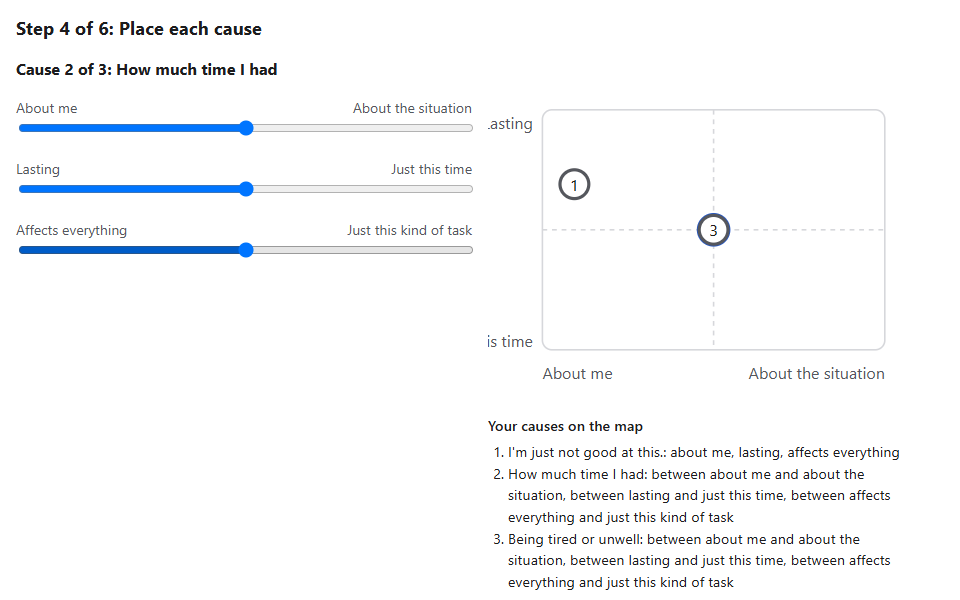 | 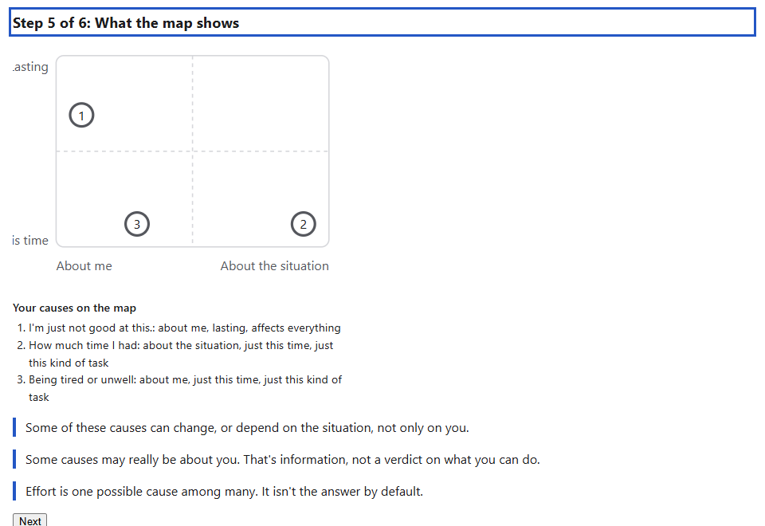 |

---

## 3. What each element does
Every element of the current chart, against the five purposes (`visual-policy.md` principle 6):

| Element | Serves | What it tells the participant | Verdict |
|---|---|---|---|
| **Frame** (rounded rectangle) | understanding | The extent of the scales: where "fully about me" and "fully about the situation" are | Keep |
| **Midlines** (dashed cross) | understanding | Which side of each scale a cause is on. The step 5 notes are about sides ("about me", "just this time"), so the sides matter | Keep; draw solid (§4, D4) |
| **Axis labels** (four) | understanding | What the two directions mean, in the slider's own words | Keep; fix the clipping (§4, D1) |
| **Cause marks** (rings) | concept, understanding | Each cause as a separate thing in a place. "Most things have more than one cause" made visible: the point of the exercise | Keep; never hide one (§4, D2) |
| **Numbers in the marks** | understanding | Which cause is which, matched to the list and the order the causes were added | Keep |
| **Highlight on the cause being placed** | interaction, feedback | Which mark the sliders are moving | Keep; make it visible and not colour-only (§4, D2, D3) |
| **Live update while a slider moves** | interaction, feedback | That the slider and the mark are the same thing | Keep, with no animation (§5.4) |
| **List under the chart** | understanding | Every cause in words, with all three answers, including the one the chart doesn't show | Keep as it is |
| **Chart text alternative** ("Map of your causes: …") | understanding | What the figure is, for screen readers; the list carries the content | Keep as it is |

Nothing in the chart is decorative. Every element earns its place, so the proposal removes nothing.

---

## 4. What's wrong today
Found by running the exercise. Each is a fact, with the screenshot that shows it.

| # | Problem | Evidence | Who it affects | Purpose it breaks |
|---|---|---|---|---|
| **D2** | **Causes in the same place hide each other.** Every cause starts in the centre (3, 3, 3), so when step 4 reaches a cause, the causes not yet placed sit on top of it: the highlighted mark, the one the sliders move, is covered. In the screenshot, cause 2 is being placed but only "3" is visible. On a "heavy" map (all causes in one corner), three causes show as one mark, "3", next to the note "That's a heavy way to see it" | `current-map-step.png`, `current-heavy.png` | Everyone | understanding, interaction, feedback |
| **D1** | **The vertical labels are cut off:** "…asting" and "…is time". The labels are anchored outside the drawing's left edge | Every screenshot | Everyone | understanding |
| **D3** | **High contrast is ignored.** In Windows High Contrast the chart keeps its own colours, so the highlight stays light blue instead of the system highlight colour, and the frame and midlines nearly disappear | `current-forced.png` | People using a contrast theme | understanding, interaction |
| **D4** | **The midlines are dashed.** In the platform's visual language a dash means "intended, not done" (the MCII bridge). Here the midlines are plain reference lines | — | Consistency across exercises | identity |

| Heavy map today: three causes, one mark | High contrast today |
|---|---|
| 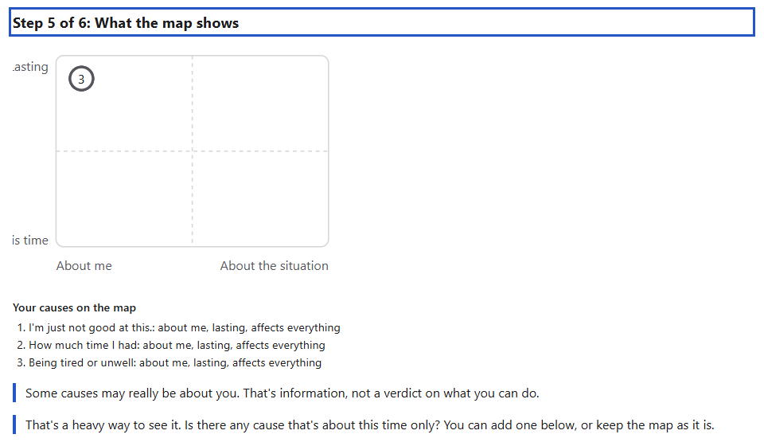 | 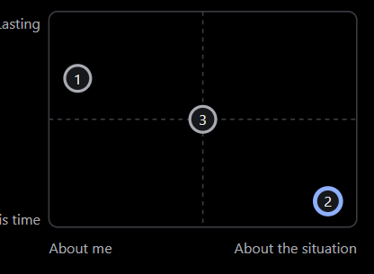 |

**Two text issues I noticed** (not the chart; decision C6 in §8):
- **Double punctuation in the list:** a card that ends with a full stop reads "I'm just not good at this.: about me, …". **Fixed in code (C6):** a cause that ends a sentence takes no colon, and its answers start a new sentence ("I'm just not good at this. About me, …"). The texts are unchanged.
- **The "Add a cause" box on a heavy map** repeats step 3's instruction, "Add at least two more; pick from these or write your own", where only one cause is being added. **For the CS2 content review (C6);** unchanged here.

---

## 5. The proposal

### 5.1 How it's approached
- **The chart stays the chart.** Same position on the page, same size, same steps, same sliders, same list. The participant should notice that it's clearer, not that it's different.
- **Every change answers one of the problems in §4,** or serves a named purpose (§5.3). Nothing is added for appearance.
- **One small change first** (§5.2), on the real screen. The rebuild follows only after you've seen it.

### 5.2 Change 1, shown first: causes in the same place are drawn together
**What changes:** when two or more causes are in exactly the same place, they're drawn as **one mark that lists their numbers**, "1 2 3", centred on that place. On step 4, the number of the cause being placed is bold, and the mark carries the highlight.

**Why this form:**
- **Every cause stays visible**, so the chart never shows fewer causes than the list.
- **Positions stay exact.** Spreading the marks out instead would move causes towards neighbouring answers, which would misreport them.
- **It says something true:** these causes are in the same place. On a heavy map, that's what the note is about.
- **It's one element doing the same job as before** (a mark with numbers), so it adds no new visual form.

| Step 4, placing cause 2: before | Step 4, placing cause 2: change 1 |
|---|---|
|  | 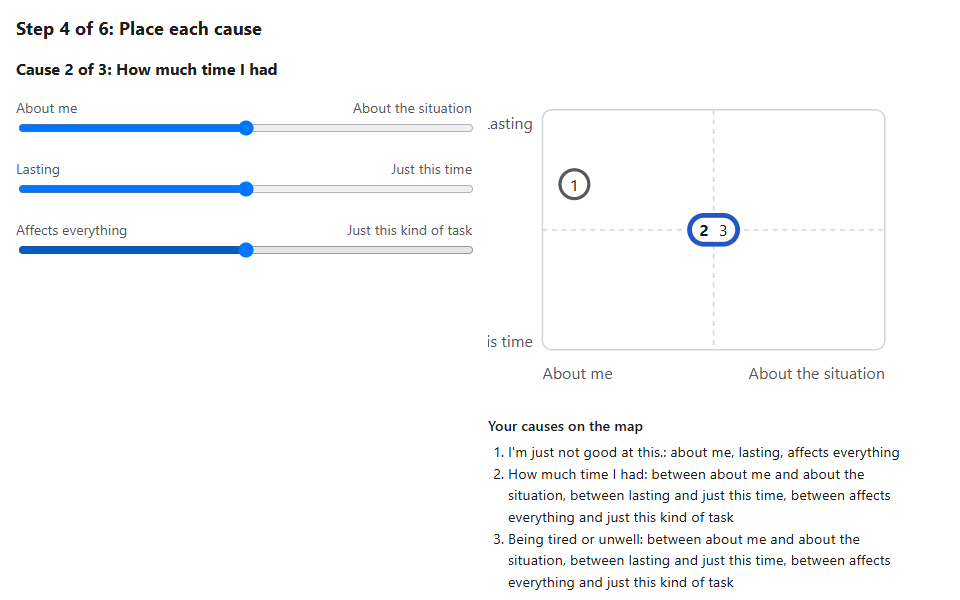 |

| Heavy map: before | Heavy map: change 1 |
|---|---|
|  | 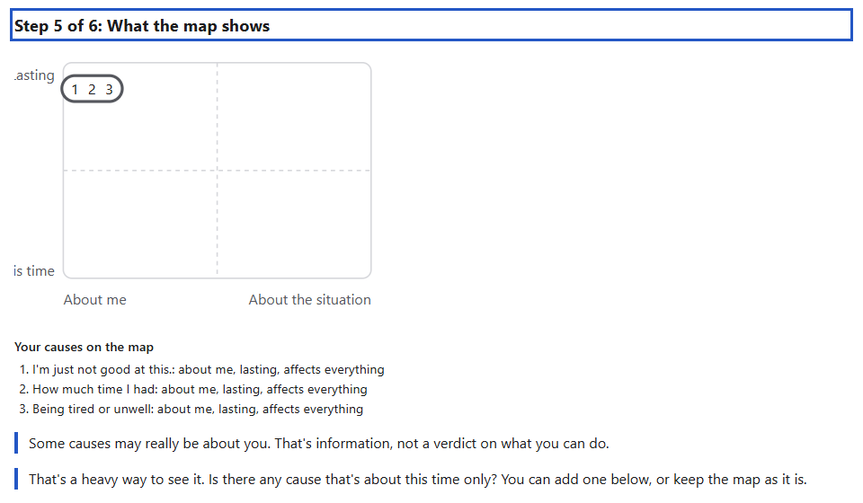 |

| Step 4, the start: every cause in the middle, cause 1 being placed (light) | The same, dark |
|---|---|
| 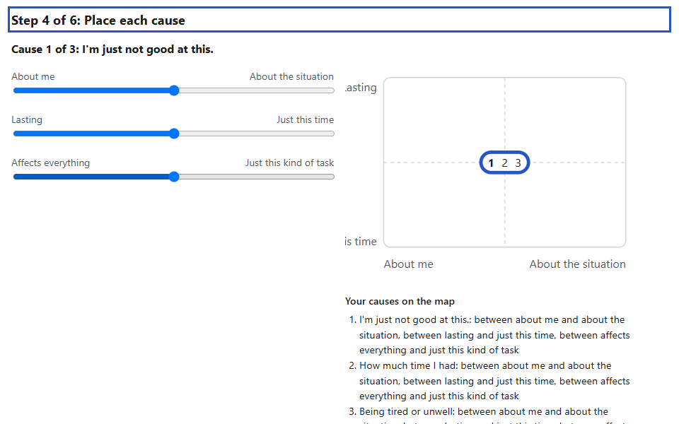 | 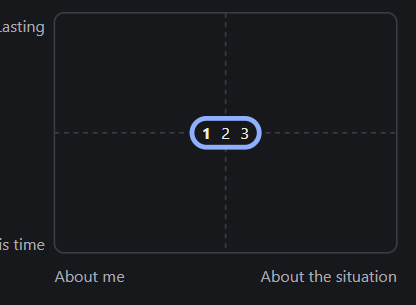 |

**As built (2026-11-08):**
- **The rule:** `mapMarks` in `cs-logic.ts` (pure, with unit tests) groups causes that share both charted answers, in list order.
- **The drawing:** the chart in `cs-why-it-happened.ts` draws one mark per place: a ring for one cause, a rounded mark 12 units wider per extra cause for several. The number of the cause being placed is bold, also when it's alone.
- **The exercise test** checks the real chart at the start of step 4 ("[1] 2 3"), after placing cause 1 ("1", "[2] 3"), on the heavy map ("1 2 3", nothing bold) and after adding a cause ("1 2 3", "4").
- **No other change:** steps, sliders, list, rules, records and content are unchanged.

**Limits:**
- With six causes in one place, the mark is about 80 units wide and can touch a neighbouring position. That's rare, and every number stays readable.
- The text list is unchanged, so screen readers get the same information as before.

The captures show change 1 alone, on the current chart, so it can be judged by itself. The clipped labels (D1) are still visible in them; the rebuild fixes those.

### 5.3 After that: the rebuild on the Visual System
Change 1 plus the fixes for D1, D3 and D4, drawn by the Visual System. **What S1 adds, and only where it serves a purpose:**

| Change | Serves | Why |
|---|---|---|
| **Labels laid out by the figure, not anchored outside it** | understanding | Fixes D1 |
| **Forced-colours mapping** (frame and lines in system text colour, the cause being placed in the system highlight colour) | understanding, interaction | Fixes D3, as for MCII |
| **Solid midlines,** in the hairline weight | identity, understanding | Fixes D4: dashes keep one meaning on the platform |
| **The cause being placed is the subject; the others are context.** On step 4, the cause being placed is drawn in the Cognitive area colour with a heavier line and a bold number. The other causes are neutral grey. On step 5, where nothing is being placed, all causes are drawn the same | interaction, feedback, identity | It answers "which one am I moving?" at a glance, without colour alone (weight, bold number and the counter above). It replaces the UI accent, which makes the mark look like a control or a focus ring. The colour separates "working on" from "not now". **It says nothing about the causes themselves:** no cause is ever coloured by where it is |
| **Line weights and label sizes from S1** | identity | The same line and type language as the MCII picture, so the platform's figures look like one family |

**Element table after the rebuild:**

| Element | S1 role | Change from today |
|---|---|---|
| Frame | `context`, hairline | Same; maps to system colours in high contrast |
| Midlines | `context`, hairline, solid | Solid instead of dashed |
| Axis labels | label tone | Not cut off |
| Cause mark (one or several causes in a place) | `context`; `subject` and one weight heavier for the cause being placed | Never hidden; the cause being placed is unmistakable |
| Numbers | label tone; bold for the cause being placed | Same numbers |
| List under the chart | — (page text) | Unchanged |
| Text alternative | — | Unchanged |

**The scene policy** (`visual-policy.md` §8), proposed:
```
Scene:       cs2.cause-map@1          Area theme: cognitive@1        Tier: instrument
Idea:        Your causes, each in its own place, by who and how long; most things have more than one cause.
States:      placing: one cause is the subject (it's being placed), the others are context
             reading: every cause the same; nothing focal
Metaphor:    A plain map with two scales. Known weakness: the third scale isn't on it (it's in the list).
Must:        every cause is visible in every state (none hidden by another); positions are exact;
             the cause being placed is shown by weight and number as well as colour;
             the list under the chart gives the same information in words.
Must not:    colour a cause by its position (no good or bad places); suggest where a cause should go;
             animate a mark while the slider moves; show the person's own words in the figure
             (the cause texts stay in the page list, as now).
Motion:      none.
Alt texts:   cs-why-it-happened map.chart_label (unchanged).
Assertions:  a policy spec for each Must and Must not.
Review:      R2 in the Lab; R3 and the psychology-trained reviewer in the test environment.
```

The cause texts the person wrote never enter the Visual System. The figure gets numbers and positions only, matching the platform rule that visual requests never carry typed text.

### 5.4 What I propose *not* to add, and why
| Not added | Why not |
|---|---|
| **Dragging marks on the chart** | The sliders already do this, keyboard-accessible and labelled in words. A second way to do the same thing adds load. A drag on a two-axis chart also can't set the third scale |
| **Animating marks when a slider moves** | The mark should follow the hand. A delay would make the chart feel slow and disconnect it from the slider |
| **Showing the third scale on the chart** (by size, fill or colour) | Size reads as importance and colour as good or bad, so both would be judgements the exercise never makes. Fill can show two values where the scale has five. The list already gives the third answer in words. Keep the approved two-axis map |
| **Coloured or labelled quadrants** ("changeable", "about you") | They would tell the person where causes *should* be. The step 5 notes already say what the map shows, chosen by rules, and the policy forbids steering |
| **Lenses, circles or other Cognitive-area forms** | They would carry no meaning here: the area's vocabulary is an option, not an obligation (`visual-language.md` §11) |
| **Showing the person's cause texts in the figure** | Long, private texts in an SVG are hard to read and harder to make accessible. The list under the chart already does this well |

### 5.5 As built: the rebuild (2026-11-08)
- **The instrument:** `shared/visual/instruments/cause-map/cause-map.ts` builds the frame from the answers (pure, no Angular). `cause-map.policy.spec.ts` asserts every Must and Must not of §5.3 for six answer sets, each while reading and while placing the first or last cause.
- **In the exercise:** `CauseMapSlot` (S9) loads the instrument and the renderer on demand and holds the map's space meanwhile. The figure keeps its text alternative and the list under it. The exercise passes places only (`positions()`), never the cause texts.
- **Change 1 moved into the instrument:** the grouping is `groupByPlace` there, so `mapMarks` left `cs-logic.ts`.
- **Size:** the map is drawn at 416 × 284, its usual width, so labels and numbers render at the S1 sizes (13 and 14 px). The vertical labels have their own margin, so "Lasting" and "Just this time" show in full; the old shortening to "This time" is gone.
- **For your review:** the solid midlines are firmer than the old light dashes. They meet the S1 line contrast (the old ones were about 1.4:1 against the page); if they compete with the marks, the next step is a lighter S1 role for reference lines, not dashes.

| Step 4, placing cause 2 (light) | Step 4, placing cause 2 (dark) |
|---|---|
| 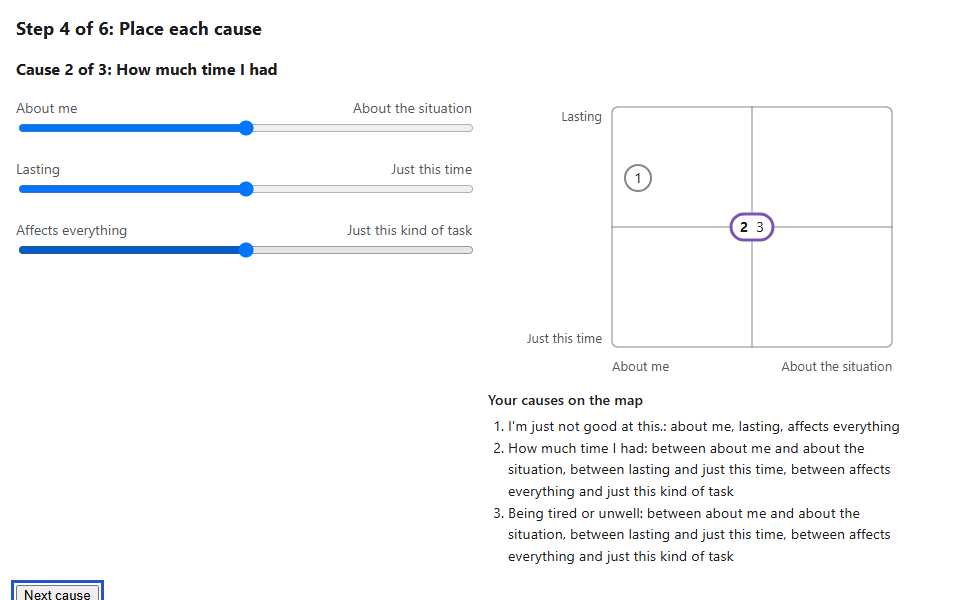 | 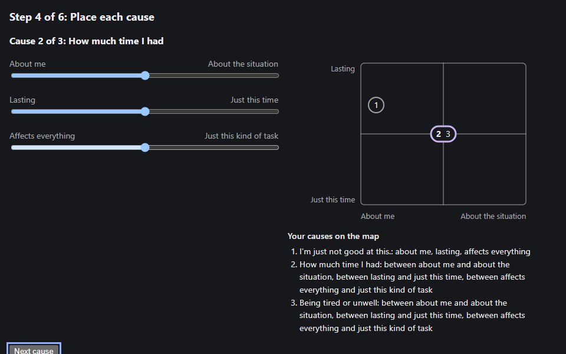 |

| Step 5, spread | Step 5, heavy map | High contrast |
|---|---|---|
| 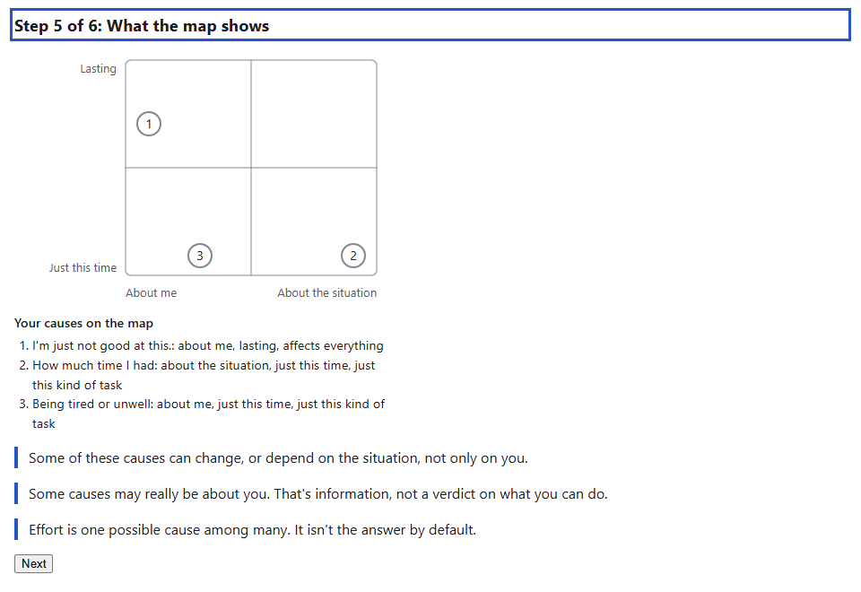 | 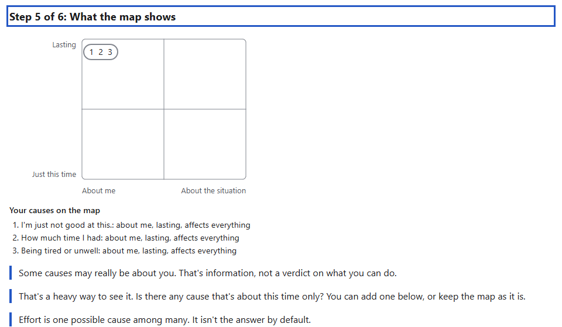 | 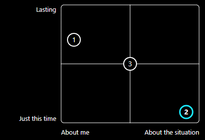 |

---

## 6. What it means for the Visual System
The release plan (`visual-system.md` §14) expected v0.2 to bring S6 Interaction, S4 parameter targets and value transitions, "validated by CS2". Applying the pull rule to this proposal, CS2 needs less:

| Capability | Needed? | Why |
|---|---|---|
| **An instrument figure drawn from the exercise's data** (tier 2, §7): typed inputs (each cause's number and its two positions, and which one is being placed), a pure function that builds the resolved frame, the existing SVG backend to draw it | **Yes** | The number of causes and their places come from the person's answers, so a fixed scene definition can't describe them |
| **Grouping of marks in the same place** | **Yes** | Change 1 |
| **Forced colours, labels, line weights** | Already built (S1) | — |
| **S6 Interaction** (pointer input on figures) | **No** | Nothing in the chart is operated directly (§5.4) |
| **Value transitions** (S5) | **No** | No motion (§5.4) |
| **S4 parameter targets** | **No**, in the planned form | The instrument builds its frame from typed data directly. Parameter targets would only wrap the same values |

If you approve, I'd revise §14: v0.2 becomes "the instrument tier (data-driven frames) and the CS2 cause map". S6 and value transitions move to whichever later composition actually needs them, with a capability-log entry for each.

**Where the code would go:**
- **The instrument:** `shared/visual/instruments/cause-map/`, with its frame function, policy spec and Lab entry.
- **The exercise:** `cs-why-it-happened.ts` replaces its inline chart with the instrument component, imported through S9 as the dependency rules require.
- **What stays in the exercise:** the steps, sliders, list, rules and records stay exactly as they are.

---

## 7. Order of work and reviews
1. **This proposal: your review.**
2. **Change 1** on the current chart in the exercise, the smallest code change that gives you the real thing to try. **Built 2026-11-08**; it goes to the test environment like any change. Tests: every cause visible when causes share a place; the bold number follows the cause being placed.
3. **The rebuild:** the instrument on the Visual System, with the fixes for D1, D3 and D4 and the subject and context colouring. It's shown in the Visual Lab next to the current chart, in both states, light, dark and high contrast, with a few sets of answers (spread out, all in one corner, all untouched in the centre).
   - **R2:** your review in the Lab.
4. **Integration** into CS2 on the development branch, replacing the inline chart and removing it. Baselines are added with the accepted review.
   - **R3 and the psychology-trained reviewer:** in the test environment, before your merge. They'd mainly check that nothing in the map reads as a verdict on the person.
5. **Docs:** `visual-system.md` §6.6, §14 and §15; `cognitive-shifts-design.md` §4 (the chart's description); `visual-reviews.md`.

If change 1 alone is enough for now, the rebuild can wait. Change 1 works on the current chart.

---

## 8. Decisions for you
| # | Decision | My recommendation |
|---|---|---|
| C1 | Change 1: causes in the same place drawn as one mark listing their numbers | **Approved and built (2026-11-08).** Try it in the test environment |
| C2 | Rebuild the chart on the Visual System with the fixes for D1, D3 and D4 | **Approved and built (2026-11-08)** |
| C3 | On step 4, the cause being placed in the Cognitive colour and heavier; the others neutral. On step 5, all causes the same | **Approved and built** |
| C4 | No dragging, no motion, no third scale on the chart, no quadrant labels (§5.4) | **Approved** |
| C5 | Revise the v0.2 scope as in §6: the instrument tier and the cause map; S6 and value transitions wait for a composition that needs them | **Approved; `visual-system.md` §14 revised** |
| C6 | The two text issues in §4 | **Decided 2026-11-08, split:** the double punctuation is fixed in code (no content change, no version bump); the heavy-map "Add a cause" wording goes to the CS2 content review |
